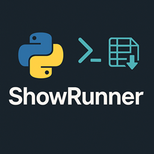
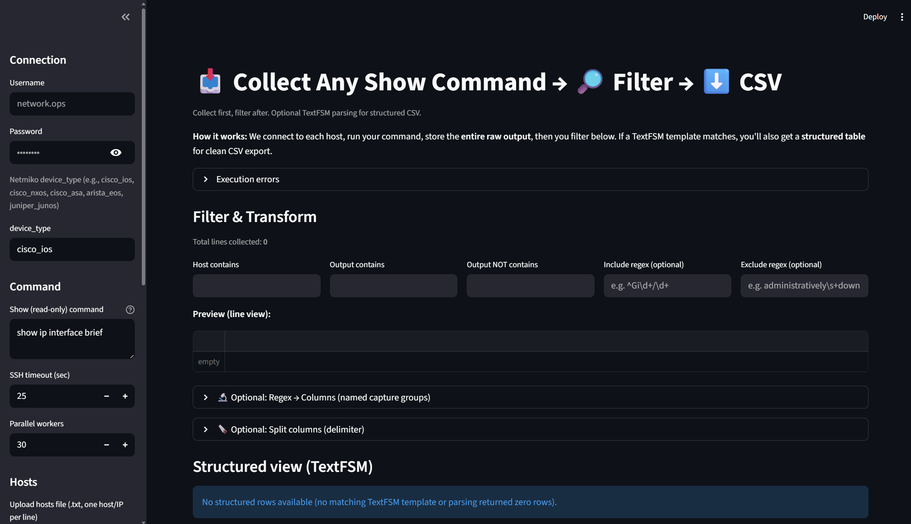
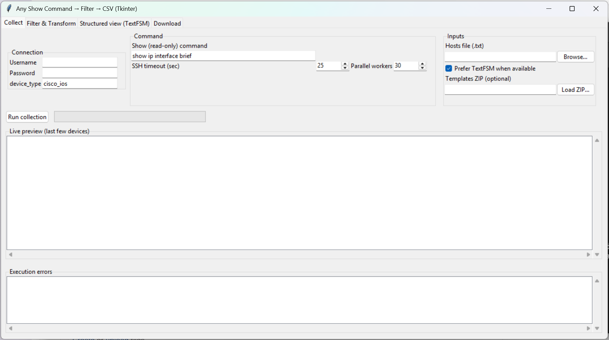

# Show_Runner



### (Streamlit Version)


### (TKinter Version)


----------------------------------------------------------

Small project. Meant for network work, but mainly as a side thing to test out vibe coding.

This app lets you run a command across a bunch of devices, collect the output, filter it, and export it.

It has a Streamlit version and a Tkinter version, and there are packaged Windows EXEs in the repo.

----------------------------------------------------------

## What it does

- Run any show command on a list of hosts
- SSH in parallel with Netmiko
- Filter output by host, text, or regex
- Parse structured output with TextFSM when a template matches
- Export filtered or raw results to CSV
- No Python needed on the target machine if you use the EXE

----------------------------------------------------------

## Repo layout

- `StreamLit/` - browser app
- `Tkinter/` - desktop app
- `Executable/` - packaged EXEs and notes
- `Images/` - screenshots

----------------------------------------------------------

## Quick start

### 1) Make a hosts file

One host/IP per line:

```text
10.1.1.1
10.1.1.2
router1.example.com
```

### 2) Run the EXE

Double-click the app or run it from CMD:

```bat
ShowRunner.exe
```

Then:
- enter username/password
- pick a device type like `cisco_ios`
- paste the show command
- upload the hosts file
- click Run collection
- filter/export as needed

----------------------------------------------------------

## Example commands

```text
show ip interface brief
show version
```

Works for a lot of devices at once.

----------------------------------------------------------

## TextFSM

TextFSM is used for cleaner structured parsing when a template is available. If not, it falls back to raw/regex filtering.

You can also upload a custom TextFSM ZIP if you want your own templates.

----------------------------------------------------------

## Build notes

Build the Tkinter version on a Windows machine with Python installed:

```bat
cd Tkinter
build_windows.bat
```

The portable app will be in `Tkinter\dist\ShowRunner`. Copy the whole folder to the engineers' machines, not just the EXE. It runs without a Python install there. The first launch may take a little longer while Windows starts the bundled app.

----------------------------------------------------------

## Notes

- This was a side project, not a polished production app
- It was meant to be useful, quick, and a little experimental
- `ShowRunner_SL.exe` = Streamlit build
- `ShowRunner_TK.exe` = Tkinter build

----------------------------------------------------------

## Credits

- Streamlit
- Tkinter
- Netmiko
- TextFSM
- ntc-templates
- Paramiko
- Pandas
